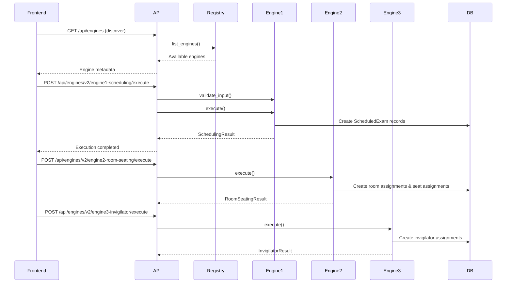

# ExamGuard Engine Specifications v2.1

Comprehensive documentation for the ExamGuard plugin-based engine architecture with enhanced categorized functionality.

## 🎯 Plugin Architecture Overview

ExamGuard uses a **plugin-based engine architecture** where engines implement a standardized `BaseEngine` interface, enabling dynamic discovery, execution, and monitoring without modifying core system code.

### Enhanced Engine Execution Flow

```
┌─────────────────────────────────────────────────────────────┐
│                  ENHANCED PLUGIN ARCHITECTURE                │
│                                                              │
│  ┌────────────────────────────────────────────────────┐    │
│  │           ENGINE REGISTRY                          │    │
│  │  • Dynamic Discovery & Analytics                   │    │
│  │  • Health Monitoring & Performance Tracking       │    │
│  │  │  • Dependency Validation & Optimization         │    │
│  │  • Execution Tracking & Metrics Collection        │    │
│  └────────────────────────────────────────────────────┘    │
│                          ↕                                   │
│  ┌────────────────────────────────────────────────────┐    │
│  │             UNIVERSAL API                          │    │
│  │  GET  /api/engines (with analytics metadata)      │    │
│  │  POST /api/engines/{name}/execute                  │    │
│  │  GET  /api/engines/{name}/health                   │    │
│  │  GET  /api/engines/{name}/analytics                │    │
│  └────────────────────────────────────────────────────┘    │
│                          ↕                                   │
│  ┌────────────────────────────────────────────────────┐    │
│  │         ENHANCED ENGINE IMPLEMENTATIONS            │    │
│  │                                                     │    │
│  │  ┌──────────────────────────────────────────┐     │    │
│  │  │ Engine 1: Enhanced Scheduling            │     │    │
│  │  │ • Conflict-optimized scheduling          │     │    │
│  │  │ • Schedule density analysis              │     │    │
│  │  │ • Gap optimization & validation          │     │    │
│  │  │ • Alternative schedule generation        │     │    │
│  │  └──────────────────────────────────────────┘     │    │
│  └────────────────────────────────────────────────────┘    │
└─────────────────────────────────────────────────────────────┘
```

## 🔌 Enhanced BaseEngine Interface

All engines implement the standardized `BaseEngine` contract with enhanced analytics capabilities:

```python
from abc import ABC, abstractmethod
from typing import Dict, Any, List

class BaseEngine(ABC):
    @abstractmethod
    def get_metadata(self) -> EngineMetadata:
        """Return engine capabilities and enhanced information"""
        
    @abstractmethod
    def validate_input(self, input_data: Dict[str, Any]) -> List[EngineValidationError]:
        """Validate input parameters with enhanced checking"""
        
    @abstractmethod
    def execute(self, input_data: Dict[str, Any], db: Session) -> EngineExecutionResult:
        """Execute with enhanced analytics and optimization"""
        
    @abstractmethod
    def get_status(self, execution_id: str) -> EngineStatus:
        """Get enhanced execution status with metrics"""
        
    @abstractmethod
    def health_check(self) -> Dict[str, Any]:
        """Enhanced health check with performance metrics"""
```

## 🚀 Engine Registration

Engines automatically register themselves on system startup:

```python
# app/main.py - Application startup
@app.on_event("startup")
def startup_event():
    from app.core.engine_registry import engine_registry
    from app.services.engine1 import Engine1SchedulingEngine
    from app.services.engine2 import Engine2RoomSeatingEngine
    from app.services.engine3 import Engine3InvigilatorEngine
    
    # Engines self-register
    engine_registry.register(Engine1SchedulingEngine())
    engine_registry.register(Engine2RoomSeatingEngine())  
    engine_registry.register(Engine3InvigilatorEngine())
```

---

## 🧠 Engine 1: Enhanced Conflict-Optimized Scheduler

**Name**: `engine1-scheduling`  
**Implementation**: `Engine1SchedulingEngine`  
**Dependencies**: None (execution order: 0)

### Purpose
Creates optimal exam timetables avoiding student conflicts using advanced constraint programming with comprehensive analysis capabilities.

### Enhanced Algorithm: Google OR-Tools CP-SAT Solver with Analytics

```python
1. Build conflict graph:
   - Nodes = courses  
   - Edges = shared students (conflicts)
   - Weights = number of shared students

2. Generate time slots with optimization:
   - Date range: start_date to end_date
   - Sessions: morning, afternoon, evening (configurable)
   - Density analysis and feasibility checking

3. Enhanced CP-SAT Model:
   - Variables: course_vars[course_id] = slot_index
   - Constraints:
     * Conflicting courses ≠ same slot
     * Minimum gap days between related exams
     * Available slot constraints
     * Optimization objectives
   - Multi-objective: Minimize maximum slot + balance load

4. Solve with analytics (60s default)
5. Generate alternatives and optimization metrics
```

### 🔍 Enhanced Categorized Functions

#### **Scheduling Analysis Functions**
- `analyze_schedule_density()` - Comprehensive exam distribution analysis with peak detection
- `analyze_student_conflicts()` - Detailed conflict matrix with severity categorization  
- `validate_schedule_feasibility()` - Pre-scheduling feasibility assessment with confidence scoring

#### **Optimization Functions**  
- `optimize_exam_gaps()` - Gap analysis with violation detection and recommendations
- `generate_alternate_schedules()` - Multiple schedule alternatives with comparative scoring
- `_calculate_optimization_score()` - Multi-factor optimization scoring (compactness + distribution)

#### **Validation Functions**
- Schedule density recommendations with utilization thresholds
- Conflict complexity assessment (LOW/MEDIUM/HIGH)  
- Gap compliance checking with severity levels
- Feasibility ratio calculations with buffer analysis

### Enhanced Input Schema
```json
{
  "plan_id": "integer",
  "course_ids": ["array of integers"],  
  "start_date": "YYYY-MM-DD",
  "end_date": "YYYY-MM-DD", 
  "sessions": ["morning", "afternoon", "evening"],
  "optimization_options": {
    "generate_alternatives": "boolean",
    "max_alternatives": "integer",
    "enable_gap_optimization": "boolean"
  },
  "user_id": "integer (optional)"
}
```

### Enhanced Output Schema  
```json
{
  "scheduled_exams": [...],
  "statistics": {
    "solver_metrics": {...},
    "density_analysis": {
      "utilization_percentage": "float",
      "peak_days": "integer",
      "load_distribution": "object"
    },
    "conflict_analysis": {
      "total_conflicts": "integer", 
      "scheduling_difficulty": "string"
    }
  },
  "alternatives": [
    {
      "alternative_id": "integer",
      "optimization_score": "float",
      "schedule_data": [...]
    }
  ],
  "recommendations": ["array of optimization suggestions"]
}
```

### Key Enhanced Features
- **Multi-Alternative Generation**: Creates 3-5 alternative schedules with comparative analysis
- **Density Analysis**: Identifies peak days and load distribution patterns
- **Gap Optimization**: Ensures adequate preparation time between related exams
- **Feasibility Prediction**: Pre-validation with confidence scoring
- **Conflict Severity**: Categorizes conflicts by impact level

### Usage Example
```bash
curl -X POST "/api/engines/v2/engine1-scheduling/execute" \
  -H "Content-Type: application/json" \
  -d '{
    "input_data": {
      "plan_id": 1,
      "course_ids": [101, 102, 103],
      "start_date": "2024-05-01", 
      "end_date": "2024-05-15",
      "sessions": ["morning", "afternoon"]
    }
  }'
```

---

## 🏢 Engine 2: Smart Room & Seating Allocator

**Name**: `engine2-room-seating`  
**Implementation**: `Engine2RoomSeatingEngine`  
**Dependencies**: `engine1-scheduling` (execution order: 1)

### Purpose
Allocates rooms and assigns exact seats with branch separation and capacity optimization.

### Dual-Mode Operation

#### Mode 1: Room Allocation
```python
Algorithm: First-Fit Decreasing
1. Sort exams by student count (largest first)
2. For each exam:
   - Find available room with sufficient capacity
   - Check time slot conflicts
   - Consider students_per_bench rule
   - Assign room or fail
3. Generate room allocation mapping
```

#### Mode 2: Seat Assignment with Branch Separation
```python  
Algorithm: Greedy with Backtracking
1. Group students by branch (CSE, ECE, MECH, etc.)
2. Create bench grid layout (row, column positions)
3. For each branch (sorted by size):
   - For each student:
     * Find valid seat position  
     * Check 8-direction neighbors for branch conflicts
     * Assign seat or backtrack
4. Generate SeatAssignment records with exact positions
```

### Input Schema
```json
{
  "scheduled_exam_ids": ["array of integers"],
  "exam_type": "MID_TERM | END_TERM | INTERNAL | EXTERNAL | MAKEUP",
  "operation": "allocate_rooms | allocate_seats | both",
  "available_room_ids": ["array of integers (optional)"], 
  "user_id": "integer (optional)"
}
```

### Output Schema
```json
{
  "room_allocation": {
    "success": "boolean",
    "allocations": {"exam_id": "room_id"},
    "statistics": {
      "total_exams": "integer",
      "rooms_used": "integer", 
      "avg_room_usage": "float"
    }
  },
  "seat_allocation": {
    "results": {
      "exam_id": {
        "success": "boolean",
        "num_assignments": "integer",
        "num_violations": "integer",
        "statistics": "object"
      }
    },
    "summary": {
      "successful": "integer",
      "failed": "integer", 
      "total_violations": "integer"
    }
  }
}
```

### Key Features
- **Capacity Optimization**: Maximizes room utilization
- **Branch Separation**: Prevents same-branch neighbors (8 directions)
- **Multi-Room Support**: Handles large exams across multiple rooms
- **Conflict Detection**: Validates seat assignments  
- **Flexible Operations**: Room-only, seat-only, or both

---

## 👨‍🏫 Engine 3: Intelligent Invigilator Manager

**Name**: `engine3-invigilator`  
**Implementation**: `Engine3InvigilatorEngine`  
**Dependencies**: `engine1-scheduling`, `engine2-room-seating` (execution order: 2)

### Purpose
Comprehensive invigilator management with eligibility checking, workload balancing, and notifications.

### Multi-Operation Engine

#### Operation 1: Eligibility Checking
```python
Algorithm: Rule-Based Validation
1. Check faculty status (active, role = FACULTY)
2. Verify availability for exam date/session  
3. Detect conflicts with existing assignments
4. Check teaching schedule conflicts
5. Validate workload limits
6. Return eligibility report with issues
```

#### Operation 2: Invigilator Assignment
```python
Algorithm: Balanced Assignment with Constraints
1. Calculate required invigilators (ratio + minimum rules)
2. Filter to eligible faculty (no ERROR-level issues)
3. For each position:
   - Select best faculty (workload balancing)
   - Assign PRIMARY, RELIEF, RESERVE roles
   - Track workload points
   - Remove from available pool
4. Generate InvigilatorAssignment records
```

#### Operation 3: Workload Balancing
```python
Algorithm: Fair Distribution Analysis  
1. Calculate current workload for all faculty
2. Analyze distribution statistics (mean, variance)
3. Identify overloaded and underutilized faculty
4. Generate rebalancing recommendations
5. Support bulk assignment with global optimization
```

### Input Schema
```json
{
  "scheduled_exam_ids": ["array of integers"],
  "exam_type": "MID_TERM | END_TERM | INTERNAL | EXTERNAL | MAKEUP", 
  "operation": "assign_invigilators | check_eligibility | balance_workload | send_notifications | bulk_assign",
  "include_relief": "boolean (default: true)",
  "include_reserve": "boolean (default: true)",
  "department_filter": "string (optional)",
  "user_id": "integer (optional)"
}
```

### Output Schema
```json
{
  "invigilator_assignments": {
    "results": {
      "exam_id": {
        "success": "boolean",
        "assignments": [
          {
            "faculty_id": "integer",
            "faculty_name": "string", 
            "role": "PRIMARY | RELIEF | RESERVE",
            "workload_points": "integer"
          }
        ],
        "warnings": ["array of strings"]
      }
    },
    "summary": {
      "total_exams": "integer",
      "successful": "integer",
      "failed": "integer", 
      "total_assignments": "integer"
    }
  },
  "eligibility_check": {
    "exam_id": {
      "total_faculty": "integer",
      "fully_eligible": "integer",
      "with_warnings": "integer",
      "ineligible": "integer",
      "faculty_details": ["array of faculty with issues"]
    }
  },
  "workload_analysis": {
    "faculty_workloads": {"faculty_id": "workload_data"},
    "statistics": {
      "average_workload": "float",
      "max_workload": "float", 
      "min_workload": "float"
    }
  }
}
```

### Key Features
- **Multi-Operation**: 5 distinct operations in one engine
- **Eligibility Validation**: Comprehensive constraint checking
- **Workload Fairness**: Balanced assignment algorithms  
- **Role Management**: PRIMARY, RELIEF, RESERVE assignments
- **Notification System**: Automated faculty communications
- **Bulk Operations**: Optimized for large-scale assignments

---

## 🔄 Engine Execution Workflow

### Typical Execution Sequence



### Execution Monitoring

Every engine execution is tracked in the `engine_executions` table:

```sql
CREATE TABLE engine_executions (
    id INTEGER PRIMARY KEY,
    execution_id VARCHAR(50) UNIQUE NOT NULL,
    engine_name VARCHAR(100) NOT NULL,
    status VARCHAR(20) NOT NULL, -- PENDING, RUNNING, COMPLETED, FAILED
    input_data TEXT, -- JSON
    output_data TEXT, -- JSON  
    started_at DATETIME,
    completed_at DATETIME,
    execution_time_ms INTEGER,
    error_message TEXT,
    user_id INTEGER REFERENCES users(id)
);
```

### Health Monitoring

Each engine provides health status:

```bash
GET /api/engines/v2/engine1-scheduling/health
{
  "status": "healthy", 
  "checks": {
    "database": "ok",
    "ortools": "ok",
    "dependencies": "ok"
  },
  "message": "Engine 1 status: healthy"
}
```

---

## 🎛️ Configuration Management

Engine behavior is controlled through database configuration:

```sql  
CREATE TABLE engine_configurations (
    id INTEGER PRIMARY KEY,
    engine_name VARCHAR(100) UNIQUE NOT NULL,
    enabled INTEGER DEFAULT 1,
    config_json TEXT, -- Engine-specific settings
    feature_flags TEXT, -- Feature toggles
    version VARCHAR(20)
);
```

### Example Configuration

```json
{
  "engine_name": "engine1-scheduling",
  "enabled": true,
  "config": {
    "solver_timeout_seconds": 60,
    "max_courses_per_batch": 100,
    "enable_gap_optimization": true
  },
  "feature_flags": {
    "advanced_conflict_detection": true,
    "multi_session_optimization": false
  }
}
```

---

## 📊 Performance Characteristics

| Engine | Typical Load | Execution Time | Memory Usage | Scalability |
|--------|--------------|----------------|--------------|-------------|
| Engine 1 | 50-100 courses | 5-30 seconds | 50-200 MB | O(n²) conflicts |
| Engine 2 | 20-50 exams | 2-10 seconds | 20-100 MB | O(n) students |  
| Engine 3 | 50-200 assignments | 1-5 seconds | 10-50 MB | O(n) faculty |

### Optimization Tips

1. **Engine 1**: Reduce course batches if timeout occurs
2. **Engine 2**: Pre-create bench layouts for faster seating
3. **Engine 3**: Cache workload calculations for bulk operations
4. **General**: Use database indexes on foreign keys

---

## 🚀 Adding New Engines

### Step-by-Step Guide

1. **Create Engine Module**
   ```bash
   mkdir -p app/services/engine5
   touch app/services/engine5/__init__.py
   touch app/services/engine5/my_engine.py
   ```

2. **Implement BaseEngine Interface**
   ```python
   # app/services/engine5/my_engine.py
   from app.core.engine_interface import BaseEngine
   
   class Engine5CustomEngine(BaseEngine):
       def get_metadata(self):
           return EngineMetadata(
               name="engine5-custom",
               display_name="My Custom Engine",
               version="1.0.0",
               description="Description of functionality",
               capabilities=["custom_feature"],
               dependencies=[],  # List required engines
               execution_order=10  # Higher = later execution
           )
       
       def validate_input(self, input_data):
           # Implement validation logic
           return []
       
       def execute(self, input_data, db):
           # Implement engine logic
           return EngineExecutionResult(...)
       
       # ... implement remaining methods
   ```

3. **Register Engine**
   ```python
   # app/services/engine5/__init__.py
   from .my_engine import Engine5CustomEngine
   __all__ = ["Engine5CustomEngine"]
   
   # app/main.py - Add to startup
   engine5 = Engine5CustomEngine()
   engine_registry.register(engine5)
   ```

4. **Test Engine**
   ```bash
   # Engine automatically available at:
   GET /api/engines/v2/engine5-custom/metadata
   POST /api/engines/v2/engine5-custom/execute
   GET /api/engines/v2/engine5-custom/health
   ```

**Files Modified**: 0-2 (only new engine files + registration)

### Benefits of Plugin Architecture

- ✅ **Zero Core Changes**: Add engines without touching existing code
- ✅ **Automatic Discovery**: Frontend automatically finds new engines
- ✅ **Standardized API**: Same endpoints for all engines  
- ✅ **Health Monitoring**: Built-in health checks and monitoring
- ✅ **Configuration**: Database-driven configuration management
- ✅ **Execution Tracking**: Automatic logging and status tracking

---

## 🔍 Debugging and Troubleshooting

### Common Issues

1. **Engine Not Registered**
   - Check import in `main.py`
   - Verify `__init__.py` exports
   - Check for import errors

2. **Validation Failures**  
   - Review input schema
   - Check required vs optional fields
   - Validate data types

3. **Execution Timeouts**
   - Increase engine-specific timeouts
   - Reduce batch sizes
   - Check resource constraints

4. **Health Check Failures**
   - Verify dependencies installed
   - Check database connectivity  
   - Review error logs

### Monitoring Endpoints

```bash
# List all engines with health status
GET /api/engines/v2/health/all

# Validate engine dependencies  
GET /api/engines/v2/dependencies/validate

# Get execution history
GET /api/engines/v2/{engine_name}/executions

# Monitor specific execution
GET /api/engines/v2/{engine_name}/status/{execution_id}
```

### Logging

All engine operations are logged with structured data:

```python
# Automatic logging includes:
{
    "timestamp": "2024-01-15T10:30:00Z",
    "engine_name": "engine1-scheduling", 
    "execution_id": "uuid-string",
    "operation": "execute",
    "input_size": 50,
    "execution_time_ms": 15000,
    "status": "completed",
    "user_id": 123
}
```

This plugin architecture enables ExamGuard to scale from 3 engines to 30+ engines without architectural changes, while maintaining performance, reliability, and ease of development.